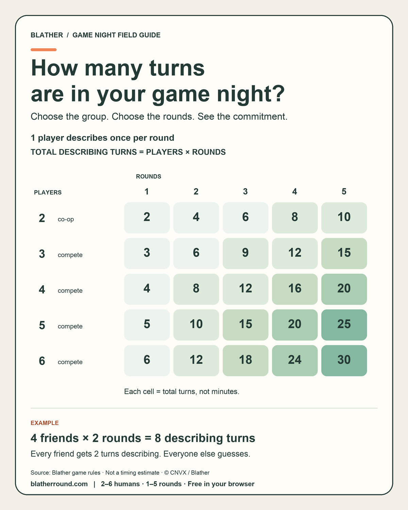

# How many turns are in your game night?

Choose the number of players (including the host) and rounds. Each player takes one describing turn in each round. Therefore **total describing turns = players × rounds**. For example, four friends playing two rounds take eight describing turns; each friend describes twice and guesses during the other turns.

The matrix covers all 25 combinations supported by [Blather](https://blatherround.com/): two to six people and one to five rounds. The two-player row is cooperative; groups of three to six use individual scores. Cells count describing turns, not clue edits, guesses, minutes or points. Color bands increase with the count and are a scanning aid, not measured difficulty.

These are calculations from the game's rules, not playtest statistics or an estimate of session duration. Each turn may end early; joining, choosing answers and recaps take additional time. Use the [current how-to-play page](https://blatherround.com/how-to-play) for gameplay and scoring details.

Prepared by the team behind Blather as a companion host-planning resource. This is our independent browser game, not an official Jackbox Blather 'Round resource. The image contains no player data, game source code or answer bank. © CNVX / Blather, 2026.
